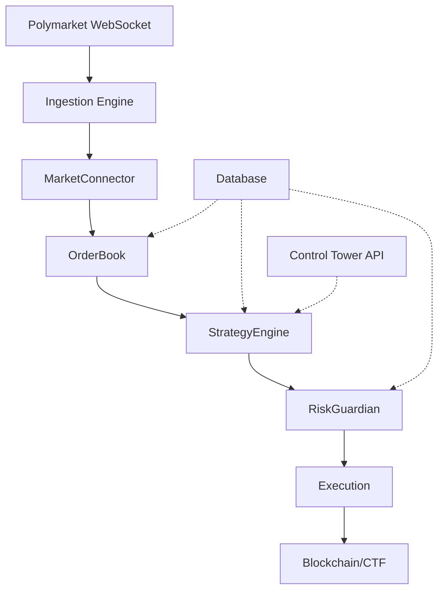

# System Architecture

## Overview

The High Frequency Polymarket Market Maker Trading Bot is designed as a modular system with clear separation of concerns. The architecture follows a pipeline pattern where market data flows through various processing stages before reaching execution.

## System Data Flow Diagram

## Component Responsibilities

### MarketConnector
- **WebSocket Heartbeat Management**: Maintains persistent connection to Polymarket WebSocket API with automatic reconnection logic
- **REST Rate Limiting**: Implements token bucket algorithm to respect API rate limits and prevent throttling
- **Connection Monitoring**: Tracks connection health and latency to detect potential issues
- **Message Parsing**: Transforms raw WebSocket messages into standardized internal data structures

### OrderBook
- **Local Snapshot Maintenance**: Maintains an in-memory representation of the order book for fast access
- **Delta Application**: Efficiently applies incremental updates (deltas) to maintain accurate order book state
- **Order Book Reconstruction**: Reconstructs the full order book from snapshots when needed
- **Top-of-Book Tracking**: Keeps track of best bid/ask prices and volumes for immediate access
- **Historical Data Buffer**: Maintains recent order book states for strategy analysis

### StrategyEngine
- **Fair Price Calculation**: Computes fair value based on order book depth and market microstructure
- **Inventory Skew Management**: Adjusts pricing based on current position exposure and risk limits
- **Spread Calculation**: Determines optimal bid-ask spreads based on market conditions and volatility
- **Quote Generation**: Generates limit orders based on calculated fair prices and risk parameters
- **Hedging Logic**: Calculates optimal hedge positions using CTF mechanics
- **Performance Metrics**: Tracks PnL, win rate, and other key trading metrics

### RiskGuardian
- **Position Limits**: Enforces maximum position sizes to prevent excessive exposure
- **Daily Loss Limits**: Implements circuit breakers to halt trading if losses exceed thresholds
- **Order Validation**: Validates all outgoing orders against risk parameters
- **Final Gatekeeping**: Acts as the final check before any network request is sent
- **Emergency Shutdown**: Provides mechanisms to immediately cease all trading activity
- **Real-time Risk Monitoring**: Continuously monitors portfolio risk metrics